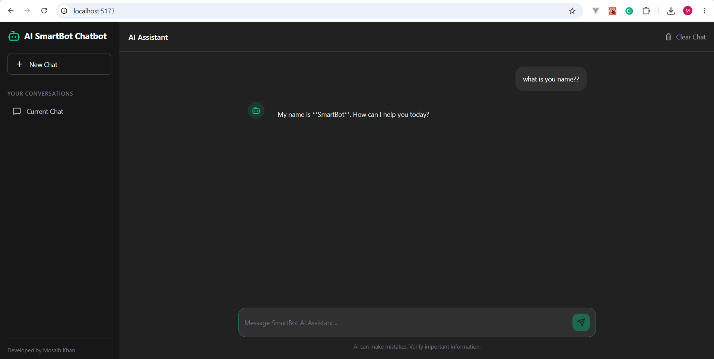
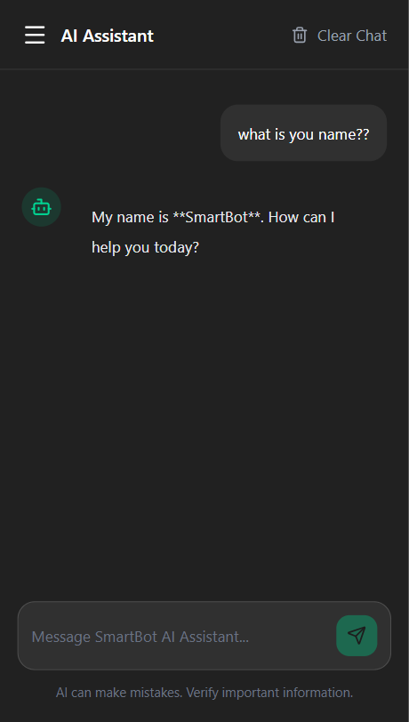

# 🤖 SmartBot AI

A full-stack AI chatbot built with **React.js, Node.js, Express.js, and OpenAI API**. SmartBot AI provides intelligent conversational responses through a modern, responsive chat interface.

## 📸 Screenshots

### Chat Interface





## ✨ Features

- AI-powered conversational responses using OpenAI.
- Real-time message interaction.
- Modern and responsive chat interface.
- New conversation functionality.
- Clear chat functionality.
- Loading indicator while generating responses.
- Context-aware conversations using message history.
- Secure API key management using environment variables.
- RESTful API integration.

## 🛠️ Tech Stack

| Technology | Purpose |
|---|---|
| React.js | Frontend UI |
| Tailwind CSS | Styling |
| Lucide React | Icons |
| Node.js | Backend runtime |
| Express.js | REST API |
| OpenAI API | AI-powered responses |
| dotenv | Environment configuration |

## 📂 Project Structure

```text
smartBot-AI/
│
├── backend/
│   ├── src/
│   │   ├── controllers/
│   │   │   └── chatController.js
│   │   ├── routes/
│   │   │   └── chatRoutes.js
│   │   └── server.js
│   ├── .env.example
│   └── package.json
│
├── frontend/
│   ├── src/
│   ├── public/
│   └── package.json
│
├── screenshots/
│   └── chatbot.png
│
├── .gitignore
└── README.md
```

## ⚙️ Installation & Setup

### Prerequisites

- Node.js and npm
- OpenAI API key

### 1. Clone Repository

```bash
git clone https://github.com/Mosaib/smartBot-AI.git

cd smartBot-AI
```

### 2. Backend Setup

```bash
cd backend

npm install
```

Create a `.env` file inside the backend directory:

```env
PORT=5000
OPENAI_API_KEY=your_openai_api_key
OPENAI_MODEL=gpt-5.5
```

Start the backend server:

```bash
npm run dev
```

Backend URL: `http://localhost:5000`

### 3. Frontend Setup

Open another terminal:

```bash
cd frontend

npm install

npm run dev
```

Frontend URL: `http://localhost:5173`

## 🔗 API Documentation

### Chat API

**Endpoint:** `/api/chat`

**Method:** `POST`

**Request Body:**

```json
{
  "messages": [
    {
      "role": "user",
      "content": "Hello! How are you?"
    }
  ]
}
```

**Response:**

```json
{
  "success": true,
  "reply": "Hello! I'm doing great. How can I help you?"
}
```

## 🔐 Environment Variables

| Variable | Description |
|---|---|
| PORT | Backend server port |
| OPENAI_API_KEY | Your OpenAI API key |
| OPENAI_MODEL | OpenAI model name |

**Security:** Never commit your `.env` file or expose your OpenAI API key in frontend code.

## 🚀 Future Improvements

- Multiple conversation management.
- Persistent chat history.
- Markdown rendering and code highlighting.
- Message copy functionality.
- Streaming AI responses.
- PDF/document-based question answering.
- User authentication.

## 👨‍💻 Author

**Md Mosaib Khan**

Full Stack Developer

- GitHub: [@Mosaib](https://github.com/Mosaib)

## 📄 License

This project is licensed under the MIT License.